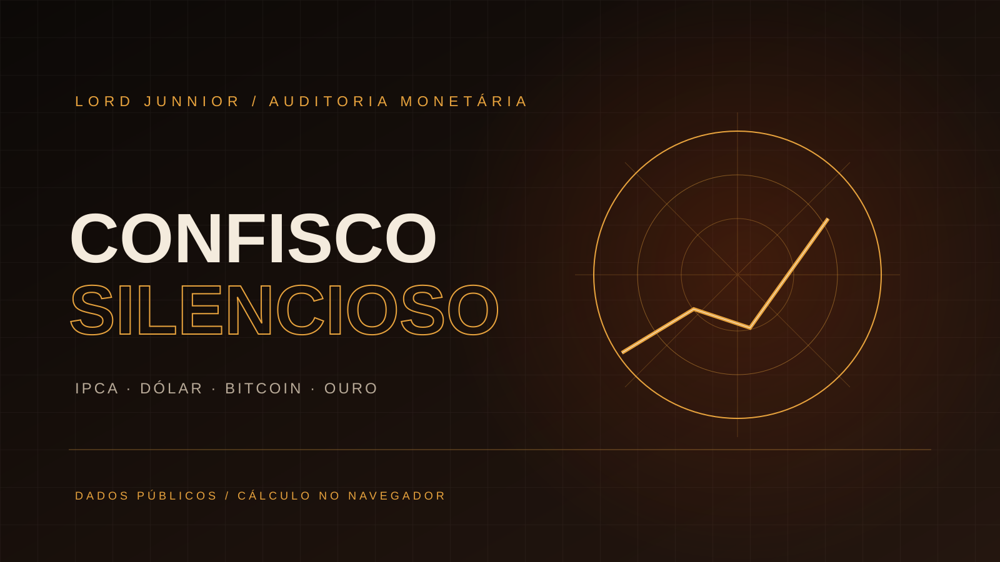

<div align="center">



# CONFISCO SILENCIOSO

**Quanto do seu poder de compra desapareceu enquanto o número na conta ficou igual?**

[](https://react.dev/)
[](https://www.typescriptlang.org/)
[](https://vite.dev/)
[](./LICENSE)

</div>

---

## Visão geral

Confisco Silencioso é uma calculadora comparativa de poder de compra. Informe um valor e um ano de referência para consultar séries públicas e comparar o resultado do real corrigido pelo IPCA com dólar, Bitcoin e uma referência de ouro tokenizado.

## O que calcula

- IPCA acumulado por composição mensal, usando a série SGS 433 do Banco Central.
- Comparação cambial com a série PTAX do Banco Central.
- Comparação histórica e atual de Bitcoin usando a API pública do mempool.space.
- Referência opcional de ouro via PAX Gold (PAXG), consultada no CoinGecko.
- Conversões e cálculos matemáticos isolados em funções testáveis.

## Fontes de dados

- [Banco Central — SGS](https://dadosabertos.bcb.gov.br/) — IPCA e dólar PTAX.
- [mempool.space API](https://mempool.space/docs/api) — histórico e preço de referência do Bitcoin.
- [CoinGecko API](https://docs.coingecko.com/) — preço de referência de PAX Gold.

A disponibilidade dos dados depende dos serviços públicos consultados. Valores históricos e comparações são aproximações baseadas nos pontos retornados pelas fontes, não uma simulação de carteira ou recomendação de investimento.

## Privacidade

O valor informado e o ano escolhido são processados no navegador e não são enviados como parâmetros às APIs. As consultas externas solicitam séries e cotações públicas. O app não pede cadastro, carteira ou chave privada.

## Executar localmente

Requisitos: Node.js 20+ e npm.

```bash
npm install
npm run dev
```

Verificações:

```bash
npm test
npm run build
```

## Arquitetura

```text
src/
├── App.tsx
├── SovereignKit.tsx
├── sovereign-suite.css
├── index.css
├── main.tsx
└── lib/
    ├── public-radar.ts
    └── public-radar.test.ts
```

## Autoria

Projeto independente de **Lord Junnior**.
